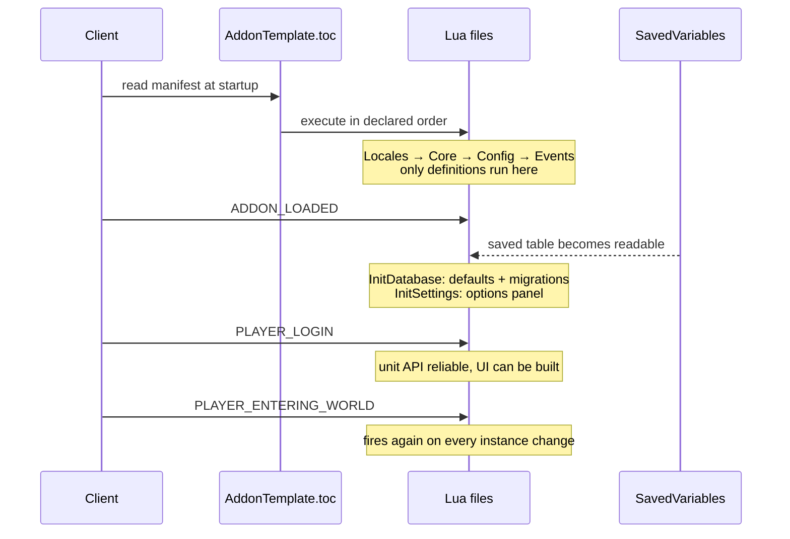
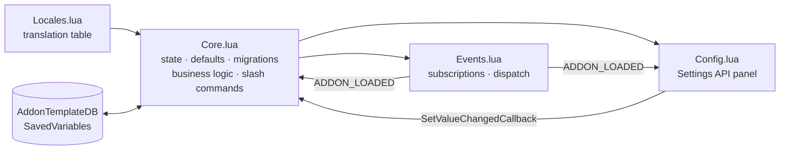

# Architecture

> Replace this file's content as the addon grows. Keep the *why*, drop the paraphrase of the
> code. What is missing six months later is never "what does this function do" — it is "why
> was it done this way, and what was rejected".

## Context

<!-- What problem does this addon solve? What did the player have to do manually before? -->

## Constraints

Every WoW addon inherits three constraints that shape its design:

1. **Shared global environment.** All addons execute in the same Lua state, with no module
   system. All state lives in the private addon table (`local ADDON_NAME, ns = ...`); the only
   globals created are the SavedVariables and the slash-command keys the client requires.
2. **Secret values (patch 12.0.0+).** Combat data is returned inside opaque boxes: tainted
   code can store, pass and display it, but cannot compare, index or compute on it. Any logic
   branching on combat state must either guard with `issecretvalue()` or delegate the
   computation to an engine-side API (curve, formatter, duration object).
3. **Single-threaded with the renderer.** Garbage collection and `OnUpdate` handlers run on
   the frame loop. Allocation per frame is a visible stutter, not a micro-optimisation.

## Load order

The critical ordering fact: **SavedVariables are `nil` until `ADDON_LOADED`**. Initialising at
file-execution time writes into nothing.

## Modules

`Events.lua` is the only file that talks to the client's event system. `Config.lua` never
mutates state directly — it calls into `Core.lua`, which owns the side effects. This keeps the
"what changes when a setting flips" answer in exactly one place.

## Configuration schema

`DEFAULTS` in `Core.lua` is the single source of truth. Two mechanisms protect stored data:

- **`ApplyDefaults`** back-fills keys added by a newer addon version, so upgrading never
  produces `nil` reads for users of an older release.
- **`MIGRATIONS`** is an ordered list where `MIGRATIONS[n]` moves the database from schema
  version `n` to `n+1`. Renaming or restructuring a key without a migration silently discards
  the user's configuration — and there is no rollback: the database is a Lua file rewritten at
  logout.

## Rejected alternatives

<!-- Record what was considered and why it lost. Examples:

- **Ace3 (AceAddon/AceDB/AceConfig)** — rejected: the native Settings API now covers the
  options panel, and every embedded library is extra surface to break on the next patch.
  Reconsider if per-character/per-spec profiles become a requirement, which AceDB solves and
  Blizzard does not.
- **XML frame definitions** — rejected: pure Lua keeps the whole addon in one language and
  greppable. Reconsider if templates start being reused across many frames.
-->

## Known limits

<!-- What does not work, and why it was accepted. -->
